<div align="center">


# SenkoOS

**Прошивка MeshCore-ретранслятора с веб-панелью, Home Assistant и автообновлением**

*MeshCore repeater firmware with a web dashboard, Home Assistant integration and signed OTA updates — see [English summary](#english)*

[](https://github.com/Geraltrot/SenkoOS/releases/latest)
[](https://github.com/Geraltrot/SenkoOS/releases)
[](https://github.com/meshcore-dev/MeshCore)
[](#поддерживаемые-платы)
[](#home-assistant)
[](license.txt)


</div>

---

> [!NOTE]
> **Новое в v1.4.0 — Heltec WiFi LoRa 32 V3 и V4.** Та же прошивка, панель и интеграции теперь и на готовых платах Heltec: экран 128×64 на четыре страницы, напряжение батареи в панели и Home Assistant, одна прошивка на обе ревизии V4 (4.2 и 4.3). Один выпуск — файлы для всех плат, у каждой платы свой подписанный манифест обновлений. [Все изменения →](diy/BACKLOG.md#v140--heltec-wifi-lora-32-v3--v4)

## Что это

SenkoOS — это обычный ретранслятор [MeshCore](https://github.com/meshcore-dev/MeshCore) (ядро не изменено), к которому добавлено всё, чего не хватает при жизни с ним дома:

| | |
|---|---|
| 🖥 **Веб-панель** | девять вкладок прямо с платы: обзор, пакеты, каналы, чат, граф путей, карта, настройки, консоль, обслуживание — на русском и английском |
| 🧙 **Мастер первой настройки** | новая плата сама поднимает точку доступа — пароль, имя и Wi-Fi задаются с телефона, без терминала |
| 🏠 **Home Assistant** | устройство и датчики появляются сами (MQTT discovery), обновление прошивки — кнопкой в HA |
| 💬 **Канал «Дом»** | приватный канал MeshCore ↔ Home Assistant: команды и уведомления в чате приложения и во вкладке «Чат» панели; ещё до 4 каналов (ключ, #хэштег, Public) — чат прямо в браузере |
| 👁 **Наблюдение за узлами** | ключевой репитер молчит дольше N часов — тревога в канал и в Home Assistant, «снова на связи» — когда вернулся |
| 🔄 **Автообновление** | только подписанные (Ed25519) выпуски для своей платы, проверка SHA-256, возврат на прежнюю версию при сбоях |
| 📟 **Экран OLED** | трафик, радио, система (и батарея на Heltec) — страницы листаются кнопкой |
| 🔋 **Батарея** | напряжение на Heltec V3 / V4 — в панели, на экране и в Home Assistant |
| 🌡 **Датчики I2C** | BME/BMP280, AHT, SHT, INA и другие находятся сами и уходят в HA и в телеметрию MeshCore |
| 🔗 **Мост LAN** | несколько ретрансляторов на одной точке (антенны в разные стороны) обмениваются пакетами по Wi-Fi, а не по эфиру; подпись HMAC, поиск узлов в сети сам |
| ✓ **Доставка** | отметка «услышан ретранслятором» у своих сообщений, повтор без эха, дозапрос потерянных частей длинного текста между платами SenkoOS |
| 🧪 **Метка SenkoOS** | платы SenkoOS видят друг друга: колба на карте и в списке узлов; транзит через каждый репитер за час |
| 📡 **Радио не ждёт** | загрузка прошивки по Wi-Fi идёт в отдельной задаче — ретрансляция не прерывается |

## Поддерживаемые платы

| | SenkoPhone 1.0 | Heltec WiFi LoRa 32 V3 | Heltec WiFi LoRa 32 V4 |
|---|---|---|---|
| **Статус** | ✅ с v1.0.0 | ✅ с v1.4.0 | ✅ с v1.4.0 (ревизии 4.2 и 4.3) |
| **Файлы выпуска** | `…-e22wroom.bin` | `…-heltec_v3.bin` | `…-heltec_v4.bin` |
| **Чип** | ESP32 (WROOM-32), 4 МБ | ESP32-S3, 8 МБ | ESP32-S3, 16 МБ + 2 МБ PSRAM |
| **Радио** | E22-900M30S: SX1262 + PA 1 Вт, до ~30 dBm | SX1262, до 22 dBm | SX1262 + усилитель, до ~28 dBm |
| **Экран** | OLED 128×128, 3 страницы | OLED 128×64, 4 страницы | OLED 128×64, 4 страницы |
| **Батарея** | — | ✅ напряжение | ✅ напряжение |
| **USB** | CH340 / CP2102 | CP2102 | встроенный USB ESP32-S3 |
| **Точка настройки** | `SenkoPhone-Setup-XXXX` | `SenkoOS-Setup-XXXX` | `SenkoOS-Setup-XXXX` |

В планах — LilyGO T3-S3 и T-Beam. Платы nRF52 (RAK4631, T-Echo) не подойдут: без Wi-Fi нет ни панели, ни Home Assistant. Хотите свою плату — откройте issue с моделью.

> [!IMPORTANT]
> **Heltec с заводской MeshCore или Meshtastic** прошивается только файлом `-merged.bin` по USB. Разметка флеша у SenkoOS другая, поэтому ключ узла и настройки прежней прошивки **не сохранятся** — узел появится в сети с новым ключом.

## Скриншоты

<table>
<tr>
<td width="50%">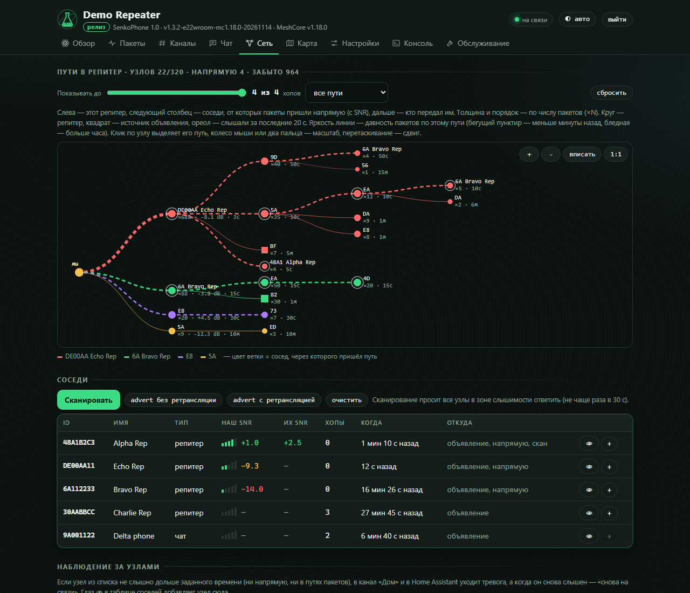<br><b>Сеть.</b> Дерево путей в репитер: яркость — давность пакетов, бегущий пунктир — живой путь, клик выделяет цепочку, колесо — масштаб. Соседи с SNR в обе стороны, сканирование, трассировка туда и обратно.</td>
<td width="50%">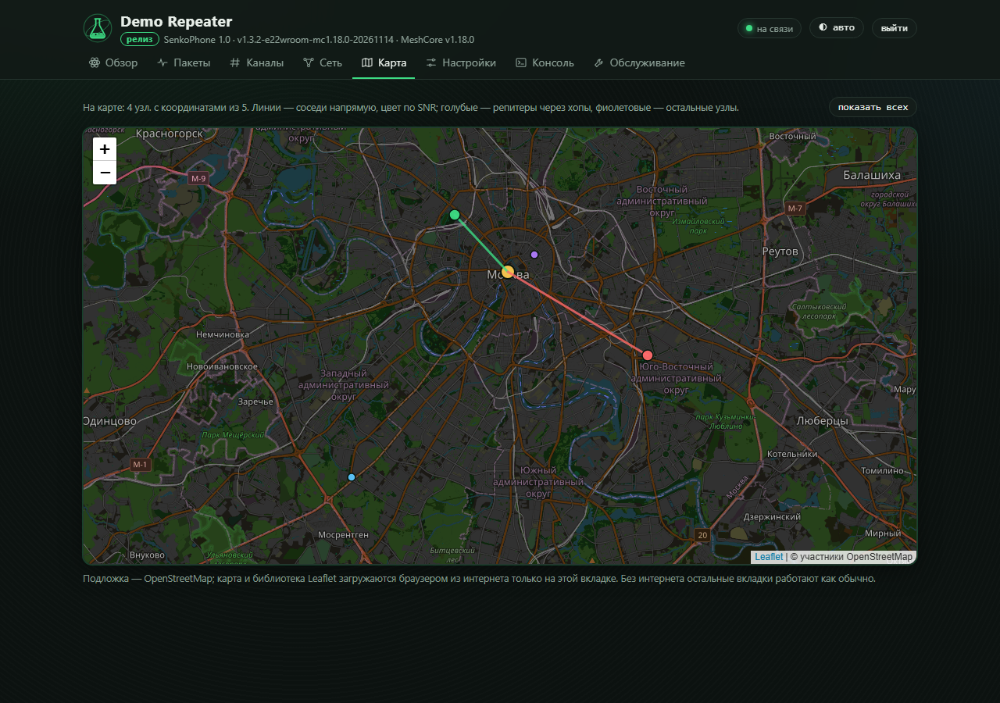<br><b>Карта.</b> Узлы, приславшие координаты: соседи напрямую — линиями с цветом по SNR. Leaflet + OpenStreetMap.</td>
</tr>
<tr>
<td>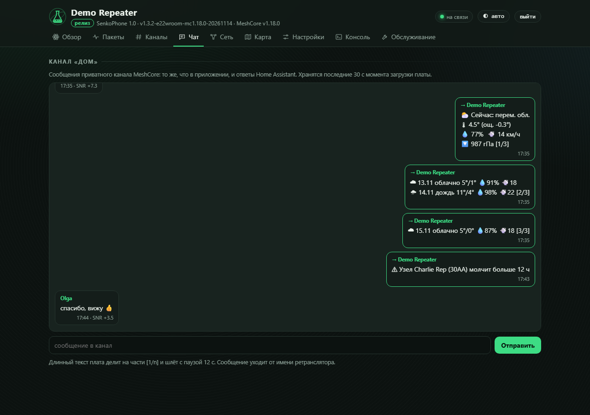<br><b>Чат.</b> Канал «Дом» прямо в панели: сообщения из приложения, ответы Home Assistant, тревоги наблюдения за узлами.</td>
<td><br><b>Обзор.</b> Аптайм и причина перезагрузки, радио, шум эфира, последний пакет, загрузка эфира, Wi-Fi, батарея (Heltec), датчики I2C.</td>
</tr>
<tr>
<td>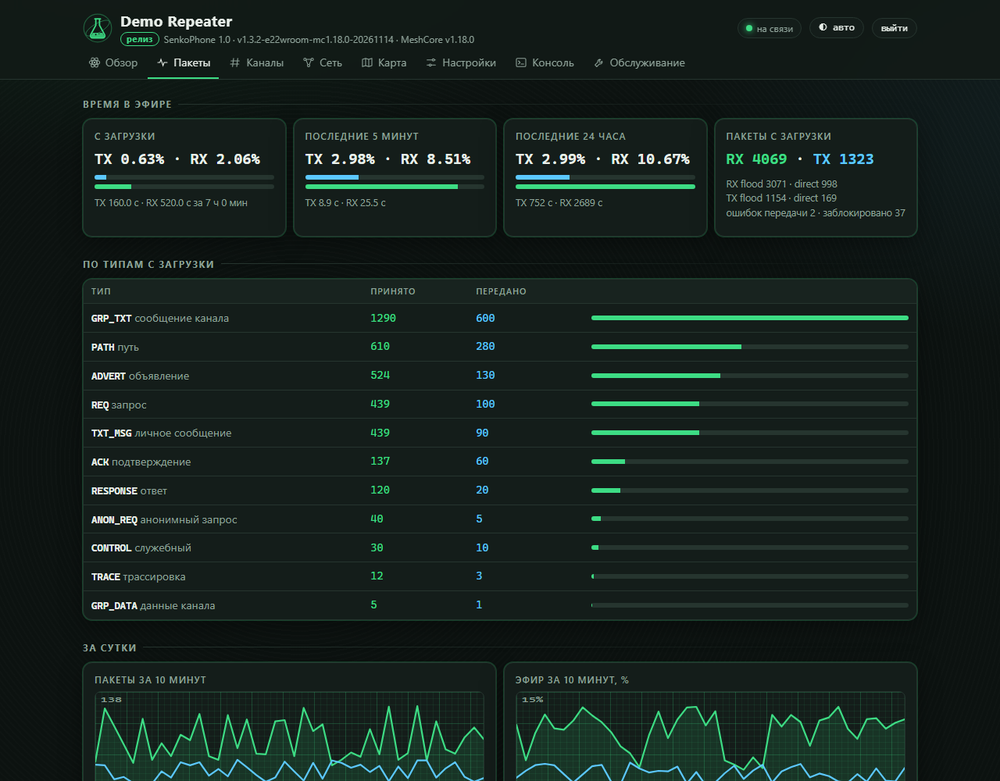<br><b>Пакеты.</b> Эфирное время за 5 минут и сутки, счётчики по типам, живой журнал.</td>
<td>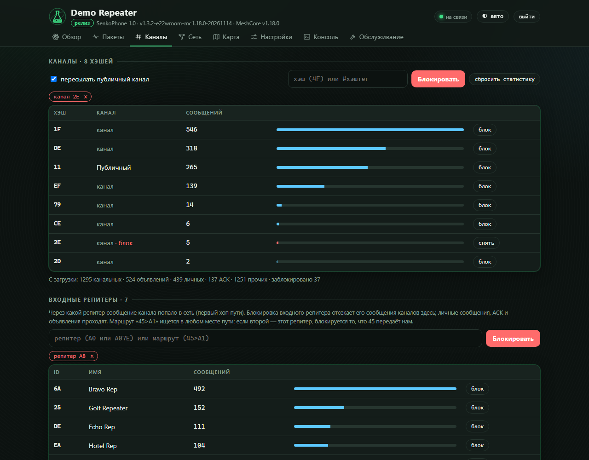<br><b>Каналы.</b> Хэши каналов со счётчиками, блокировка канала, #хэштега, входного репитера или маршрута A&gt;B.</td>
</tr>
<tr>
<td><br><b>Обслуживание.</b> Автообновление, загрузка прошивки по Wi-Fi (файл проверяется по содержимому, прошивку для другого чипа плата не примет), пароль веб-входа.</td>
<td><br><b>Мастер первой настройки.</b> Открывается сам при подключении к точке доступа платы.</td>
</tr>
</table>

<details>
<summary><b>Настройки целиком</b> — каждое поле — команда CLI</summary>
<br>
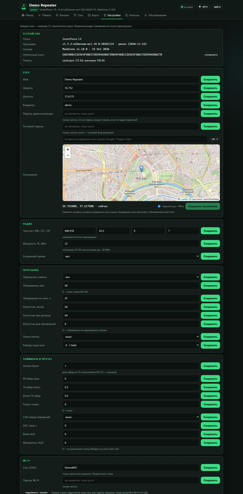
</details>

### Экран

**SenkoPhone — 128×128:** главная · радио · система · точка настройки.

<p>
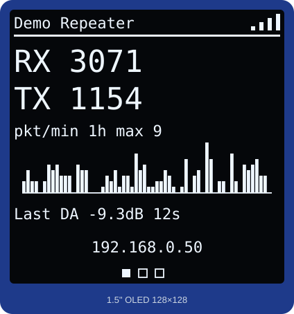
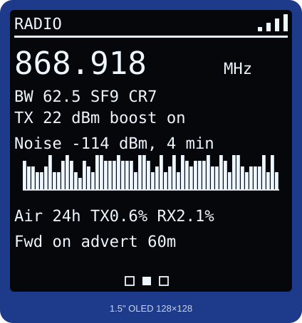
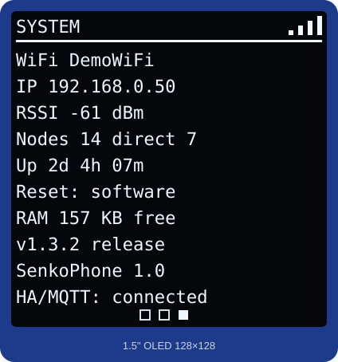

</p>

**Heltec V3 / V4 — 128×64:** главная · радио · система · инфо (батарея, версия, плата). Точки страниц — в шапке.

<p>
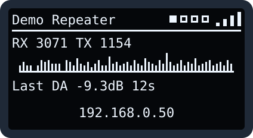
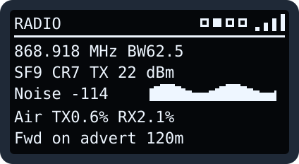
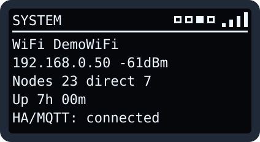
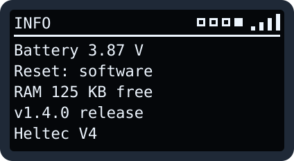
</p>

Короткое нажатие кнопки (на Heltec — **PRG**) — следующая страница, тройное — мастер настройки, долгое — выключение. *(Схемы экранов с демо-данными.)*

## Быстрый старт

1. Скачайте файл **своей платы** с окончанием `-merged.bin` из [последнего выпуска](https://github.com/Geraltrot/SenkoOS/releases/latest):

   | Плата | Файл | `--chip` |
   |---|---|---|
   | SenkoPhone 1.0 | `v1.4.0-mc1.18.0-…-e22wroom-merged.bin` | `esp32` |
   | Heltec V3 | `v1.4.0-mc1.18.0-…-heltec_v3-merged.bin` | `esp32s3` |
   | Heltec V4 | `v1.4.0-mc1.18.0-…-heltec_v4-merged.bin` | `esp32s3` |

2. Прошейте его по USB **на адрес `0x0`** — из браузера ([esptool-js](https://espressif.github.io/esptool-js/)) или командой:
   ```bash
   python -m esptool --chip esp32s3 --port COM5 erase_flash
   python -m esptool --chip esp32s3 --port COM5 write_flash 0x0 v1.4.0-mc1.18.0-…-heltec_v4-merged.bin
   ```
   Не подключается — режим загрузки вручную: зажать **BOOT** (на Heltec — **PRG**), нажать и отпустить **RST**, отпустить BOOT.
3. На экране появится **SETUP** с именем сети и паролем. Подключитесь телефоном — откроется мастер: пароль администратора, имя, домашний Wi-Fi.
4. Готово: адрес панели — на экране платы. Дальнейшие обновления — файлом `…-<плата>.bin` (без `-merged`) через «Обслуживание» или автоматически.

Подробно, с восстановлением и частыми ошибками, — [`diy/FLASHING.md`](diy/FLASHING.md) (для Heltec — раздел 1а).

## Home Assistant

```
mqtt host 192.168.1.x
mqtt user <пользователь Mosquitto>
mqtt pwd <пароль>
mqtt on
```

В HA появляется устройство с датчиками: принято/передано пакетов, пакеты в минуту, шум эфира, SNR/RSSI последнего пакета, загрузка эфира за сутки, узлы в сети, соседи напрямую, **напряжение батареи** (Heltec); диагностика — аптайм, Wi-Fi, память, причина перезагрузки; **«Прошивка»** с кнопкой «Установить»; найденные **датчики I2C**.

### Канал «Дом»

Приватный канал MeshCore, который ретранслятор передаёт в HA и обратно. Пишете в приложении `погода` — Home Assistant отвечает в тот же чат:

```
⛅ Сейчас: перем. обл.
🌡 4.5° (ощ. -0.3°)
💧 77%  💨 14 км/ч
🔽 987 гПа [1/3]
```

Длинный ответ из HA можно отправить одним сообщением — плата сама разделит его на пакеты `[1/3]`, `[2/3]`… и пошлёт с паузой, чтобы порядок не перепутался. Ключ канала задаётся на плате (`home channel <ключ>`), в эфире он не появляется. Пример автоматизации с белым списком команд — в [`diy/README.md`](diy/README.md#канал-дом-чат-с-home-assistant-через-mesh).

> [!WARNING]
> В групповом канале отправителя подтверждает только ключ канала — давайте через него только безопасные команды.

## Автообновление

- Плата раз в сутки читает **манифест своей платы** из последнего выпуска — `manifest.json` (SenkoPhone), `manifest-heltec_v3.json`, `manifest-heltec_v4.json` — и проверяет **подпись Ed25519** открытым ключом, вшитым в прошивку.
- Совпала плата, версия новее, бета разрешена, образ для своего чипа — файл пишется во второй слот, **SHA-256 сверяется до переключения**.
- Если новая версия трижды перезагрузится, не проработав 10 минут, плата **сама вернётся** на прежнюю.
- Режимы: выключено / только сообщать / ставить ночью. Канал бета — по желанию (`update beta on`).

## Железо: SenkoPhone 1.0

| Узел | Что стоит | Пины ESP32 |
|---|---|---|
| MCU | ESP32 DevKit V1 (WROOM-32, 4 МБ flash) | — |
| Радио | EBYTE E22-900M30S (SX1262 + PA 1 Вт) | NSS 18, SCK 5, MOSI 27, MISO 19, NRST 23, BUSY 32, DIO1 33, TXEN 13, RXEN 14 |
| Экран | OLED 128×128 SH1107, I2C 0x3C | SDA 21, SCL 22 |
| Кнопка | активный низкий, внешняя подтяжка | GPIO39 |
| Датчики | любые поддерживаемые на той же шине I2C | SDA 21, SCL 22 |

Мощность SX1262 ограничена 22 dBm — на выходе E22 это около 30 dBm.

Платы Heltec используют пины из вариантов MeshCore ([`variants/heltec_v3`](variants/heltec_v3), [`variants/heltec_v4`](variants/heltec_v4)) без изменений; у V4 мощность в настройках — это мощность чипа SX1262, усилитель платы добавляет к ней своё.

## Сборка из исходников

```bash
pip install platformio
pio run -e DIY_E22_WROOM32_repeater                # SenkoPhone: firmware.bin
pio run -e DIY_E22_WROOM32_repeater -t mergebin    # + firmware-merged.bin
pio run -e SenkoOS_heltec_v3_repeater              # Heltec V3
pio run -e SenkoOS_heltec_v4_repeater              # Heltec V4
```

Веб-страница — `diy/firmware/web/index.html`; при сборке сжимается и встраивается в прошивку. Если открыть её с диска, она покажет демо-данные (`?heltec` в адресе — вариант для Heltec) — так удобно править дизайн без платы. Подробности устройства прошивки — [`diy/README.md`](diy/README.md), планы — [`diy/BACKLOG.md`](diy/BACKLOG.md).

## Основа и лицензия

SenkoOS — неофициальная сборка поверх [MeshCore](https://github.com/meshcore-dev/MeshCore) `repeater-v1.18.0`. Файлы MeshCore не изменены, своё — в `diy/`, `variants/diy_e22_wroom32/` и `variants/senkoos_heltec/`. Лицензия — MIT, как у MeshCore ([license.txt](license.txt)).

---

## English

**SenkoOS** is a [MeshCore](https://github.com/meshcore-dev/MeshCore) repeater firmware (unmodified core) for the **SenkoPhone 1.0** (ESP32 + EBYTE E22-900M30S) and, since v1.4.0, the **Heltec WiFi LoRa 32 V3 / V4**, with:

- a **web dashboard** served by the board, in English or Russian: overview, packets, channel/route blocking, chat, path graph with live paths and zoom, map, all settings, console, maintenance;
- a **first-run wizard** over the board's own access point (no serial terminal needed);
- **Home Assistant** via MQTT discovery: traffic and radio sensors, battery voltage (Heltec), auto-detected I2C sensors (BME/BMP280, AHT, SHT, INA…), a firmware **update entity**;
- a private **"Home" channel** bridged to Home Assistant — commands and notifications in a normal MeshCore chat — plus up to 4 more channels (key, #hashtag, Public) to chat from the browser;
- **signed OTA updates** per board (Ed25519 manifest, SHA-256 and chip check, automatic rollback after failed boots), installed without stopping packet forwarding;
- a **LAN bridge**: several repeaters at one site (antennas in different directions) exchange packets over Wi-Fi instead of the air (HMAC-signed UDP, automatic discovery);
- **delivery marks**: "heard re-sent by N repeaters" on our own chat messages, a resend when there is no echo, and SenkoOS boards ask for lost parts of long texts;
- a **SenkoOS mark** in the advert: SenkoOS boards show each other on the map, plus transit traffic through every repeater;
- an **OLED** UI: 128×128 on SenkoPhone, 128×64 on Heltec.

| Board | Release file | `--chip` |
|---|---|---|
| SenkoPhone 1.0 | `…-e22wroom-merged.bin` | `esp32` |
| Heltec V3 | `…-heltec_v3-merged.bin` | `esp32s3` |
| Heltec V4 (rev. 4.2 and 4.3) | `…-heltec_v4-merged.bin` | `esp32s3` |

Flash the `-merged.bin` of your board from the [latest release](https://github.com/Geraltrot/SenkoOS/releases/latest) at `0x0` (on a Heltec coming from stock MeshCore/Meshtastic the node key and settings are not kept), join the `SenkoPhone-Setup-XXXX` / `SenkoOS-Setup-XXXX` Wi-Fi shown on the screen and follow the wizard. Later updates: `…-<board>.bin` over Wi-Fi or automatically. The web UI speaks **English and Russian** (switch in the header; English by default for non-Russian browsers). MIT license, like MeshCore.
