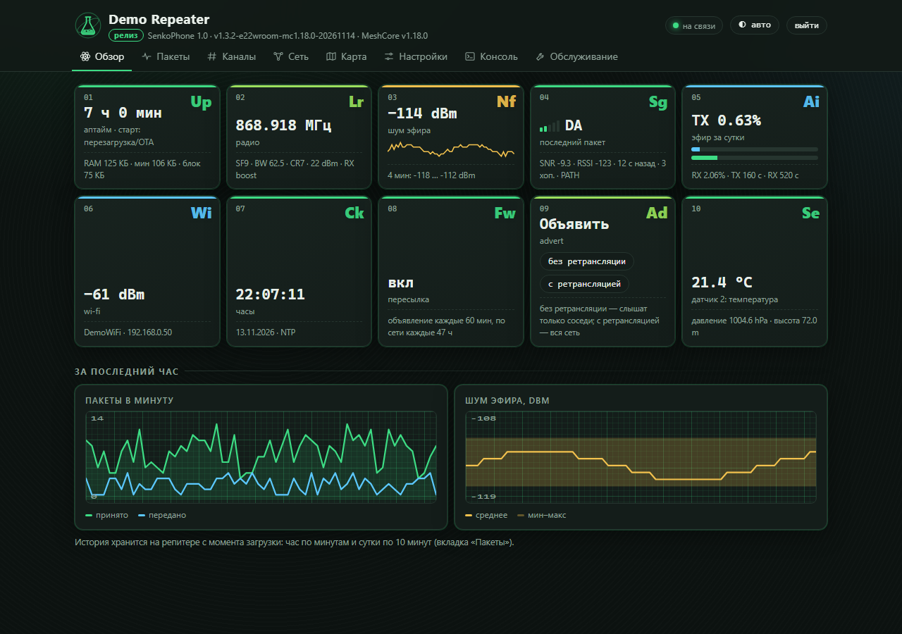
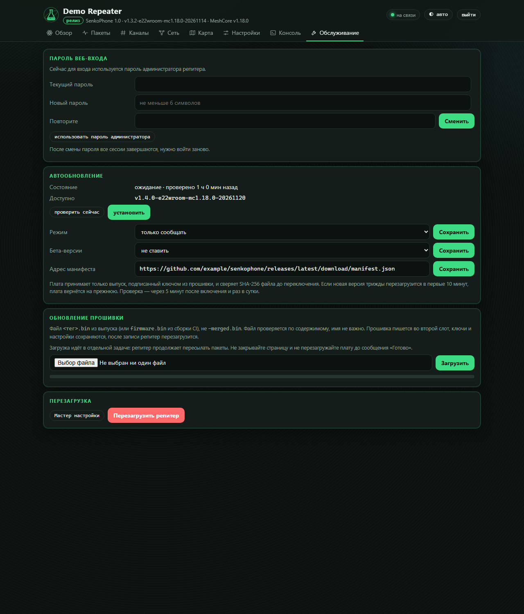
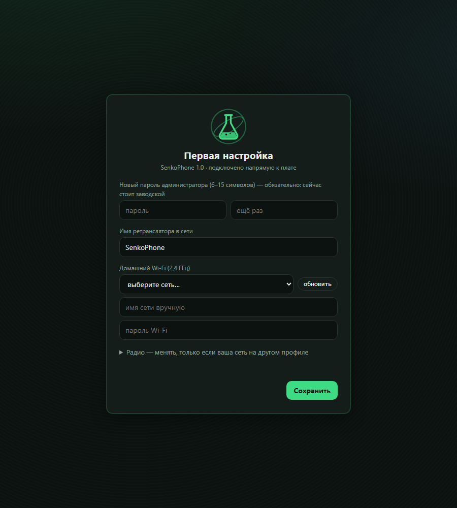
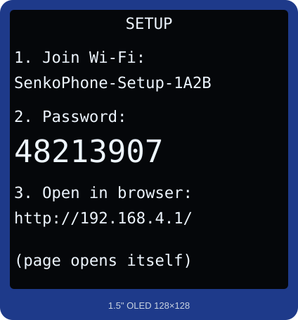

<div align="center">


# SenkoOS

**Прошивка MeshCore-ретранслятора с веб-панелью, Home Assistant и автообновлением**

*MeshCore repeater firmware with a web dashboard, Home Assistant integration and signed OTA updates — see [English summary](#english)*

[](https://github.com/meshcore-dev/MeshCore)
[](#железо-senkophone-10)
[](#home-assistant)
[](license.txt)
[](https://github.com/Geraltrot/SenkoOS/releases/latest)



</div>

---

## Что это

SenkoOS — это обычный ретранслятор [MeshCore](https://github.com/meshcore-dev/MeshCore) (ядро не изменено), к которому добавлено всё, чего не хватает при жизни с ним дома:

| | |
|---|---|
| 🖥 **Веб-панель** | восемь вкладок прямо с платы: обзор, пакеты, каналы, граф путей, карта, настройки, консоль, обслуживание |
| 🧙 **Мастер первой настройки** | новая плата сама поднимает точку доступа — пароль, имя и Wi-Fi задаются с телефона, без терминала |
| 🏠 **Home Assistant** | устройство и датчики появляются сами (MQTT discovery), обновление прошивки — кнопкой в HA |
| 💬 **Канал «Дом»** | приватный канал MeshCore ↔ Home Assistant: команды и уведомления в обычном чате приложения |
| 🔄 **Автообновление** | только подписанные (Ed25519) выпуски, проверка SHA-256, возврат на прежнюю версию при сбоях |
| 📟 **Экран OLED** | три страницы: трафик, радио, система — листаются кнопкой |
| 🌡 **Датчики I2C** | BME/BMP280, AHT, SHT, INA и другие находятся сами и уходят в HA и в телеметрию MeshCore |
| 📡 **Радио не ждёт** | загрузка прошивки по Wi-Fi идёт в отдельной задаче — ретрансляция не прерывается |

## Скриншоты

<table>
<tr>
<td width="50%"><br><b>Сеть.</b> Дерево путей в репитер: яркость — давность пакетов, бегущий пунктир — живой путь, клик выделяет цепочку, колесо — масштаб. Соседи с SNR в обе стороны, сканирование, трассировка туда и обратно.</td>
<td width="50%"><br><b>Карта.</b> Узлы, приславшие координаты: соседи напрямую — линиями с цветом по SNR. Leaflet + OpenStreetMap.</td>
</tr>
<tr>
<td><br><b>Пакеты.</b> Эфирное время за 5 минут и сутки, счётчики по типам, живой журнал.</td>
<td><br><b>Каналы.</b> Хэши каналов со счётчиками, блокировка канала, #хэштега, входного репитера или маршрута A&gt;B.</td>
</tr>
<tr>
<td><br><b>Обслуживание.</b> Автообновление, загрузка прошивки по Wi-Fi (файл проверяется по содержимому), пароль веб-входа.</td>
<td><br><b>Мастер первой настройки.</b> Открывается сам при подключении к точке доступа платы.</td>
</tr>
</table>

<details>
<summary><b>Настройки целиком</b> — каждое поле — команда CLI</summary>
<br>

</details>

### Экран

<p>



</p>

Главная · Радио · Система · Точка настройки. Короткое нажатие — следующая страница, тройное — мастер настройки, долгое — выключение. *(Схемы экранов с демо-данными.)*

## Быстрый старт

1. Скачайте `…-merged.bin` из [последнего выпуска](https://github.com/Geraltrot/SenkoOS/releases/latest).
2. Прошейте его по USB **на адрес `0x0`** — из браузера ([esptool-js](https://espressif.github.io/esptool-js/)) или командой:
   ```bash
   python -m esptool --chip esp32 --port COM3 erase_flash
   python -m esptool --chip esp32 --port COM3 write_flash 0x0 v1.3.2-e22wroom-mc1.18.0-…-merged.bin
   ```
3. На экране появится **SETUP** с именем сети `SenkoPhone-Setup-XXXX` и паролем. Подключитесь телефоном — откроется мастер: пароль администратора, имя, домашний Wi-Fi.
4. Готово: адрес панели — на экране платы. Дальнейшие обновления — через «Обслуживание» или автоматически.

Подробно, с восстановлением и частыми ошибками, — [`diy/FLASHING.md`](diy/FLASHING.md).

## Home Assistant

```
mqtt host 192.168.1.x
mqtt user <пользователь Mosquitto>
mqtt pwd <пароль>
mqtt on
```

В HA появляется устройство с датчиками: принято/передано пакетов, пакеты в минуту, шум эфира, SNR/RSSI последнего пакета, загрузка эфира за сутки, узлы в сети, соседи напрямую; диагностика — аптайм, Wi-Fi, память, причина перезагрузки; **«Прошивка»** с кнопкой «Установить»; найденные **датчики I2C**.

### Канал «Дом»

Приватный канал MeshCore, который ретранслятор передаёт в HA и обратно. Пишете в приложении `погода` — Home Assistant отвечает в тот же чат:

```
⛅ Сейчас: перем. обл.
🌡 4.5° (ощ. -0.3°)
💧 77%  💨 14 км/ч
🔽 987 гПа [1/3]
```

Ключ канала задаётся на плате (`home channel <ключ>`), в эфире он не появляется. Пример автоматизации с белым списком команд — в [`diy/README.md`](diy/README.md#канал-дом-чат-с-home-assistant-через-mesh).

> ⚠️ В групповом канале отправителя подтверждает только ключ канала — давайте через него только безопасные команды.

## Автообновление

- Плата раз в сутки читает `manifest.json` последнего выпуска и проверяет **подпись Ed25519** открытым ключом, вшитым в прошивку.
- Совпала плата, версия новее, бета разрешена — файл пишется во второй слот, **SHA-256 сверяется до переключения**.
- Если новая версия трижды перезагрузится, не проработав 10 минут, плата **сама вернётся** на прежнюю.
- Режимы: выключено / только сообщать / ставить ночью. Канал бета — по желанию.

## Железо: SenkoPhone 1.0

| Узел | Что стоит | Пины ESP32 |
|---|---|---|
| MCU | ESP32 DevKit V1 (WROOM-32, 4 МБ flash) | — |
| Радио | EBYTE E22-900M30S (SX1262 + PA 1 Вт) | NSS 18, SCK 5, MOSI 27, MISO 19, NRST 23, BUSY 32, DIO1 33, TXEN 13, RXEN 14 |
| Экран | OLED 128×128 SH1107, I2C 0x3C | SDA 21, SCL 22 |
| Кнопка | активный низкий, внешняя подтяжка | GPIO39 |
| Датчики | любые поддерживаемые на той же шине I2C | SDA 21, SCL 22 |

Мощность SX1262 ограничена 22 dBm — на выходе E22 это около 30 dBm.

## Другие платы

Сейчас SenkoOS собирается для SenkoPhone 1.0. Всё своё (панель, MQTT, обновления) живёт в `diy/firmware/` и не зависит от радио, поэтому перенос на другие **ESP32-платы MeshCore** — это вариант платы и раскладка экрана:

| Плата | Статус |
|---|---|
| SenkoPhone 1.0 (ESP32 + E22-900M30S) | ✅ |
| Heltec WiFi LoRa 32 V3 / V4 | 🗺 в планах: ESP32-S3, OLED 128×64 — нужна своя раскладка экрана |
| LilyGO T3-S3, T-Beam | 🗺 в планах |
| nRF52 (RAK4631, T-Echo) | — нет Wi-Fi: панель и HA недоступны |

Хотите свою плату — откройте issue с моделью.

## Сборка из исходников

```bash
pip install platformio
pio run -e DIY_E22_WROOM32_repeater          # firmware.bin
pio run -e DIY_E22_WROOM32_repeater -t mergebin   # firmware-merged.bin
```

Веб-страница — `diy/firmware/web/index.html`; при сборке сжимается и встраивается в прошивку. Если открыть её с диска, она покажет демо-данные — так удобно править дизайн без платы. Подробности устройства прошивки — [`diy/README.md`](diy/README.md), планы — [`diy/BACKLOG.md`](diy/BACKLOG.md).

## Основа и лицензия

SenkoOS — неофициальная сборка поверх [MeshCore](https://github.com/meshcore-dev/MeshCore) `repeater-v1.18.0`. Файлы MeshCore не изменены, своё — в `diy/` и `variants/diy_e22_wroom32/`. Лицензия — MIT, как у MeshCore ([license.txt](license.txt)).

---

## English

**SenkoOS** is a [MeshCore](https://github.com/meshcore-dev/MeshCore) repeater firmware (unmodified core) for an ESP32 + EBYTE E22-900M30S board ("SenkoPhone 1.0") with:

- a **web dashboard** served by the board: overview, packets, channel/route blocking, path graph with live paths and zoom, map, all settings, console, maintenance;
- a **first-run wizard** over the board's own access point (no serial terminal needed);
- **Home Assistant** via MQTT discovery: traffic and radio sensors, auto-detected I2C sensors (BME/BMP280, AHT, SHT, INA…), a firmware **update entity**;
- a private **"Home" channel** bridged to Home Assistant — commands and notifications in a normal MeshCore chat;
- **signed OTA updates** (Ed25519 manifest, SHA-256 check, automatic rollback after failed boots), installed without stopping packet forwarding;
- a three-page **128×128 OLED** UI.

Flash `…-merged.bin` from the [latest release](https://github.com/Geraltrot/SenkoOS/releases/latest) at `0x0`, join the `SenkoPhone-Setup-XXXX` Wi-Fi shown on the screen and follow the wizard. The UI is in Russian for now. MIT license, like MeshCore.
